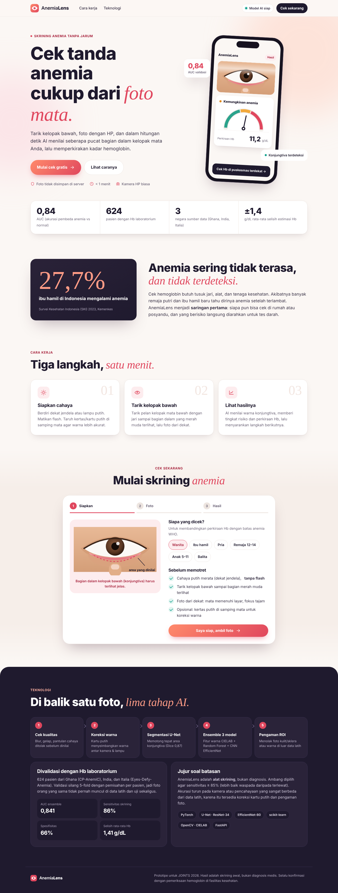
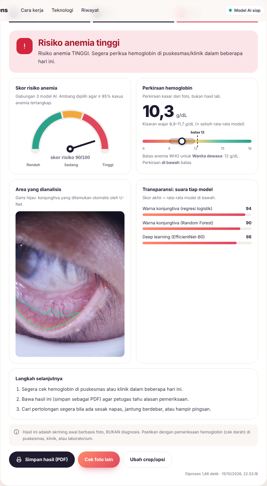
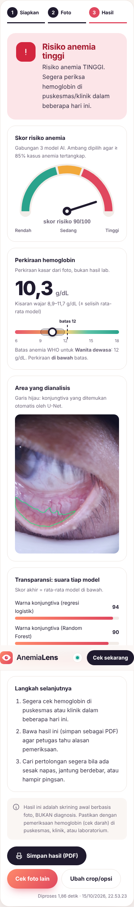

# AnemiaLens

**Skrining anemia tanpa jarum dari foto kelopak mata bawah.** Pengguna memotret bagian dalam kelopak mata bawah (konjungtiva), lalu AI menilai seberapa pucat jaringan itu dan memberi tingkat risiko anemia (rendah / sedang / tinggi), perkiraan kadar hemoglobin (Hb), serta saran langkah berikutnya.

> AnemiaLens adalah alat **skrining**, bukan diagnosis. Hasil selalu perlu dikonfirmasi dengan pemeriksaan Hb (tes darah) di puskesmas, klinik, atau laboratorium.

Prototipe untuk **JOINTS 2026 (Hackathon, Healthcare)**.

| Halaman utama | Hasil cek | Tampilan HP |
| --- | --- | --- |
|  |  |  |

---

## Hasil validasi

Divalidasi pada **624 pasien dari 3 negara** (Ghana, India, Italia) dengan Hb laboratorium, memakai validasi silang 5-fold yang dipisah per pasien.

| Metrik | Nilai |
| --- | --- |
| AUC ensemble | **0,841** (95% CI 0,810–0,870) |
| Sensitivitas (ambang skrining) | 0,859 |
| Spesifisitas | 0,662 |
| Selisih rata-rata perkiraan Hb (MAE) | 1,41 g/dL |
| Dice segmentasi konjungtiva (U-Net v2) | 0,83 foto asli · 0,87 simulasi foto HP |

Laporan lengkap: [`hasil_model_v2/report.md`](hasil_model_v2/report.md).

---

## Cara menjalankan web

### Cara 1 — Windows, sekali klik (paling mudah)

1. Pasang **Python 3.11–3.14** dari [python.org](https://www.python.org/downloads/). Saat memasang, **centang "Add python.exe to PATH"**.
2. Download repo ini: tombol hijau **Code → Download ZIP**, lalu ekstrak. Atau dengan git:
   ```bash
   git clone https://github.com/brianmacrio/AnemiaLens.git
   ```
3. Klik dua kali **`Jalankan_AnemiaLens_Web.bat`**.
   - Pertama kali: file ini membuat lingkungan Python `.venv` dan memasang paket (±5–10 menit, butuh internet).
   - Berikutnya: langsung jalan dalam beberapa detik.
4. Browser terbuka otomatis ke **http://localhost:8000**. Tunggu sampai label kanan atas berubah menjadi **"Model AI siap"** (±10–20 detik).
5. **Membuka dari HP:** sambungkan HP ke WiFi yang sama dengan laptop, lalu buka alamat **"Dari HP"** yang tertulis di jendela hitam (contoh `http://192.168.1.5:8000`). Jika Windows Firewall bertanya, pilih **Allow**.
6. Untuk berhenti, tutup jendela hitam.

### Cara 2 — Manual (Windows, macOS, Linux)

```bash
cd AnemiaLens
python -m venv .venv

# Windows
.venv\Scripts\activate
# macOS / Linux
source .venv/bin/activate

pip install -r web/requirements.txt
python web/server.py
```

Lalu buka **http://localhost:8000**. Opsi server:

| Opsi | Fungsi |
| --- | --- |
| `--port 8000` | Ganti port |
| `--model <folder>` | Pakai folder model lain (berisi `thresholds.json`) |
| `--no-browser` | Jangan buka browser otomatis |

### Cara 3 — Google Colab (link HTTPS publik untuk HP siapa pun)

1. Buka [`AnemiaLens_Web_Colab.ipynb`](AnemiaLens_Web_Colab.ipynb) di [Google Colab](https://colab.research.google.com/).
2. Buat zip dari folder `hasil_model_v2` (isi: `model/` dan `report.md`), lalu **Runtime → Run all** dan upload zip itu saat diminta.
3. Buka link `https://….trycloudflare.com` yang muncul. Link aktif selama sesi Colab berjalan.

---

## Cara memakai

1. **Siapkan** — pilih siapa yang dicek (Wanita, Ibu hamil, Pria, Remaja, Anak, Balita) supaya batas Hb WHO yang dipakai sesuai.
2. **Foto** — cari cahaya putih (dekat jendela), **jangan pakai flash**, tarik kelopak mata bawah sampai bagian dalam yang merah muda terlihat, lalu foto dari dekat. Opsional: taruh kertas putih di samping mata dan aktifkan "Ada kertas/kartu putih".
3. **Analisis** — pilih mode **Otomatis (AI)**. Jika garis hijau meleset, pilih **"Lingkari sendiri"** dan lingkari bagian dalam kelopak bawah dengan jari atau mouse.
4. **Hasil** — tingkat risiko, skor, perkiraan Hb dan kisarannya, skor tiap model, serta langkah selanjutnya. Tekan **"Simpan hasil (PDF)"** untuk dibawa ke puskesmas.

Foto **tidak disimpan** di server. Riwayat cek hanya tersimpan di browser perangkat itu.

---

## Cara kerja

```
Foto ─► Cek kualitas ─► Koreksi kartu putih ─► Segmentasi U-Net v2 ─► Pengaman ROI
        (blur, cahaya)    (opsional)             (atau lingkaran)       (tolak kulit/sklera)
                                                         │
                     ┌───────────────────────────────────┘
                     ▼
        24 fitur warna + gambar ROI ─► 3 model ─► rata-rata ─► risiko + perkiraan Hb
                                       • Regresi logistik (warna)
                                       • Random Forest (warna)
                                       • CNN EfficientNet-B0
```

- **Segmentasi:** U-Net (encoder ResNet-34) memotong area konjungtiva. Versi v2 dilatih dengan augmentasi "konjungtiva pucat" dan "foto HP" (zoom-out, blur, JPEG, white balance) agar mengenali mata anemia dan foto HP biasa.
- **Fitur warna:** 24 fitur dari CIELAB (a\* = kemerahan), HSV, rasio kromatik, erythema index, high hue ratio, dan entropi.
- **Ambang:** skor ≥ 0,614 → tinggi; 0,426–0,614 → sedang; < 0,426 → rendah (ambang skrining dipilih agar ≥ 85% kasus anemia tertangkap).
- **Pengaman:** foto buram, gelap, atau bukan konjungtiva ditolak dengan saran perbaikan.

Penjelasan lengkap (use case, arsitektur, teknologi, algoritma front end dan back end): **[`AnemiaLens_Dokumentasi_Teknis_Sistem.docx`](AnemiaLens_Dokumentasi_Teknis_Sistem.docx)**.

---

## API

Server juga bisa dipakai lewat API. Dokumentasi interaktif tersedia di `http://localhost:8000/api/docs`.

| Endpoint | Fungsi |
| --- | --- |
| `GET /api/info` | Status model dan metrik validasi |
| `POST /api/analyze` | Analisis satu foto (form-data: `file`, `use_card`, `polygon`, `force`) |

```bash
curl -F "file=@foto_mata.jpg" http://localhost:8000/api/analyze
```

---

## Struktur repo

| Path | Isi |
| --- | --- |
| `Jalankan_AnemiaLens_Web.bat` | Pemasang + peluncur web sekali klik (Windows) |
| `web/server.py` | Server FastAPI (halaman web + API) |
| `web/static/` | Front end: `index.html`, `style.css`, `app.js` (tanpa framework) |
| `web/requirements.txt` | Daftar paket Python |
| `web/preview/` | Screenshot tampilan |
| `anemialens/` | Kode AI: segmentasi, fitur warna, model, training, inferensi |
| `hasil_model_v2/model/` | Model terlatih yang dipakai web |
| `hasil_model_v2/report.md` | Laporan validasi |
| `AnemiaLens_Colab.ipynb` | Notebook training lengkap (Google Colab, GPU T4) |
| `AnemiaLens_Latih_Ulang_Segmentasi.ipynb` | Notebook latih ulang segmentasi saja |
| `AnemiaLens_Web_Colab.ipynb` | Notebook menjalankan web di Colab |
| `AnemiaLens_Dokumentasi_Teknis_Sistem.docx` | Dokumentasi teknis lengkap |

## Dataset

Dataset **tidak disertakan** di repo ini (ukuran besar dan lisensinya tidak mengizinkan distribusi ulang). Untuk melatih ulang, unduh dari sumber aslinya:

- **Eyes-defy-anemia** (India + Italia): [IEEE DataPort](https://ieee-dataport.org/documents/eyes-defy-anemia)
- **CP-AnemiC** (Ghana, hanya untuk keperluan akademik): [Mendeley Data](https://data.mendeley.com/datasets/m53vz6b7fx/1)

## Keterbatasan

- Data latih berupa foto close-up dari alat khusus dan potongan konjungtiva. Foto HP biasa, screenshot, atau gambar internet berukuran kecil berada di luar data latih, sehingga hasilnya kurang pasti.
- Model belum divalidasi pada data Indonesia.
- Perkiraan Hb bersifat kasar (±1,4 g/dL) dan tidak menggantikan tes darah.

## Mengunggah perubahan ke GitHub (untuk tim)

1. Pasang [Git for Windows](https://git-scm.com/download/win) (pilihan default).
2. Klik dua kali **`push_ke_github.bat`** di folder proyek (macOS/Linux: `./push_ke_github.sh`).
3. Pertama kali: isi nama dan email GitHub, lalu login GitHub di jendela browser yang muncul.

Script ini otomatis menyambungkan folder ke repo, melewati file yang tidak perlu (`data/`, `.venv/`, `*.zip`, arsip), menolak file > 95 MB, membuat commit, lalu push. Jika ada perubahan di GitHub yang bentrok dengan file lokal, script berhenti tanpa mengubah apa pun. Pesan commit sendiri: `push_ke_github.bat "Perbaiki tampilan hasil"`.

## Mengatasi masalah

| Masalah | Solusi |
| --- | --- |
| `python` tidak dikenali | Pasang ulang Python dan centang "Add python.exe to PATH" |
| Instalasi paket gagal | Periksa internet; hapus folder `.venv` lalu jalankan `.bat` lagi |
| Label "Server offline" | Jalankan server dulu; jangan membuka `index.html` langsung dari folder |
| Tampilan masih versi lama | Tekan **Ctrl+F5** di browser |
| HP tidak bisa membuka | Pastikan HP dan laptop di WiFi yang sama dan Firewall mengizinkan |
| Port 8000 sudah dipakai | Tutup server lama, atau jalankan `python web/server.py --port 8080` |
